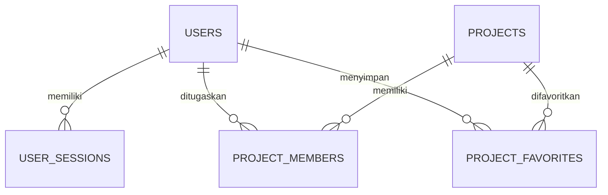

# Relasi database fondasi

Keanggotaan dan favorit memakai primary key gabungan agar asosiasi unik. Token sesi disimpan sebagai hash SHA-256. Status dan deadline proyek diindeks untuk pembacaan portofolio. Migrasi pertama membuat tabel dengan charset utf8mb4.
